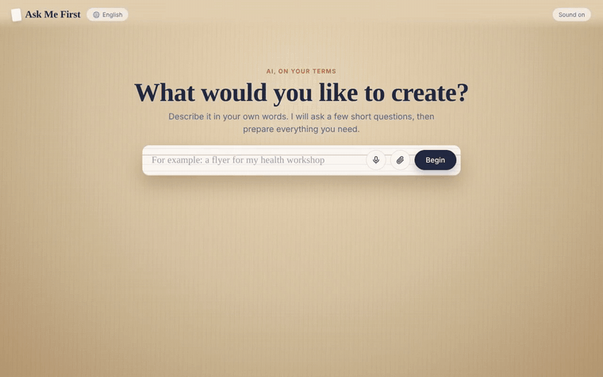
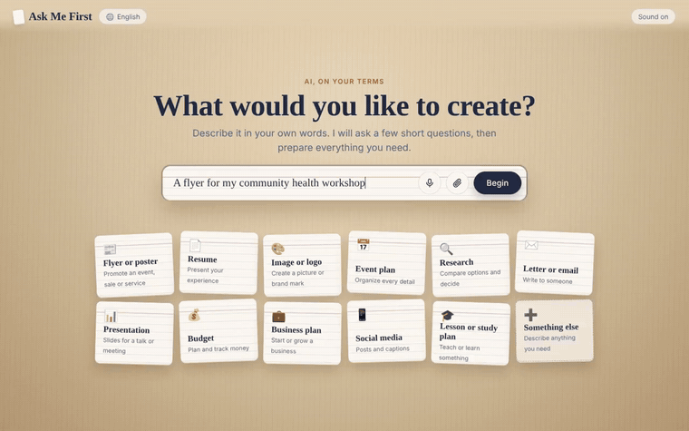
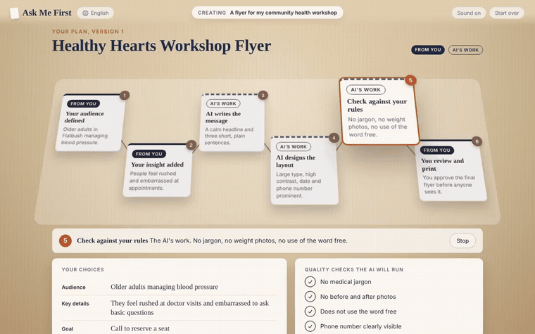
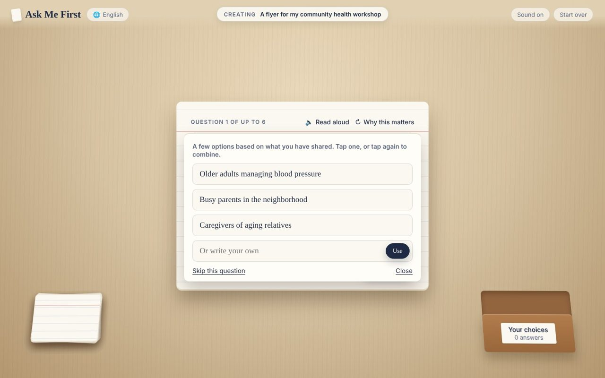
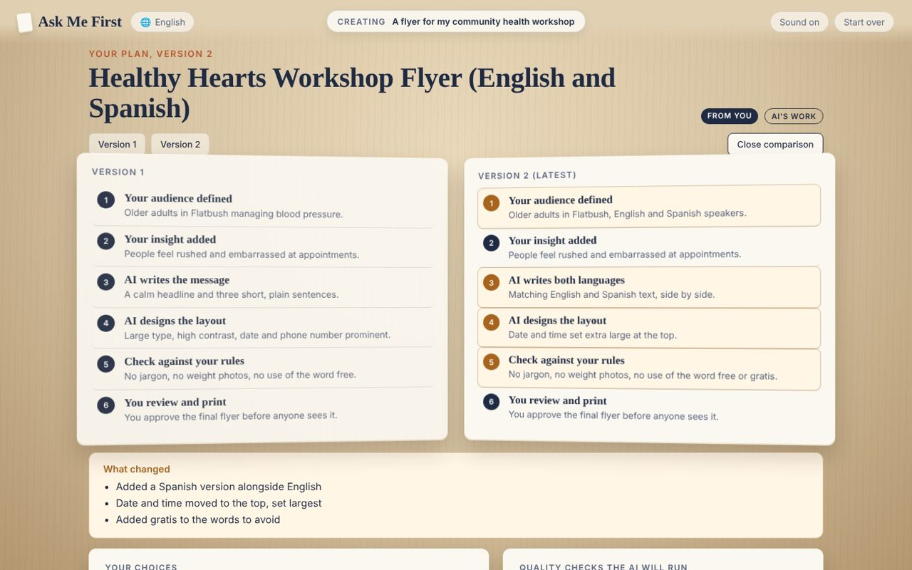
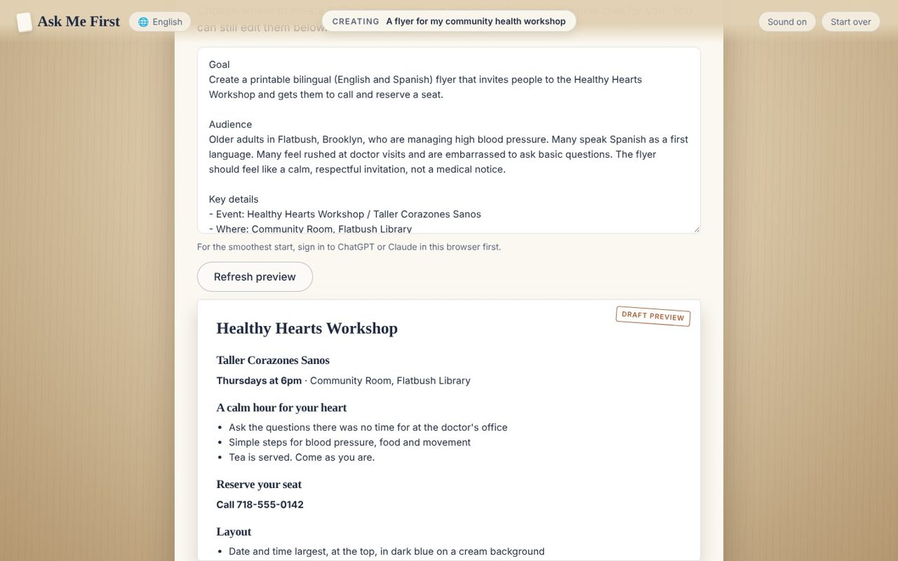
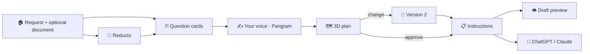

<div align="center">

# 🗂️ Ask Me First

### Most people don't know how to talk to AI. So this AI asks first.



**Cards → your voice → a plan you can see → expert instructions in ChatGPT or Claude**

Built solo in one day · Non-Slop Hackathon · Pangram × Nous Research × Reducto × Modal · Brooklyn, Nov 22, 2026

📥 [**Download the 3-minute presentation**](docs/AskMeFirst.pptx) &nbsp;·&nbsp; 🎬 [Watch the clips](#-see-it-in-motion) &nbsp;·&nbsp; 🚀 [Run it](#-run-it)

</div>

---

## 🎬 See it in motion

<table>
<tr>
<td width="50%" align="center"><a href="docs/videos/02_cards.mp4"></a><br><b>1 · It asks first</b><br>One card at a time, about <i>your</i> request</td>
<td width="50%" align="center"><a href="docs/videos/03_voice.mp4"></a><br><b>2 · Your voice, verified</b><br>Pangram confirms the words are yours</td>
</tr>
<tr>
<td align="center"><a href="docs/videos/04_plan.mp4"></a><br><b>3 · See the plan</b><br>From you vs. AI's work, played in 3D</td>
<td align="center"><a href="docs/videos/05_compare.mp4"></a><br><b>4 · Change it, compare</b><br>Version 2 opens like a book</td>
</tr>
<tr>
<td colspan="2" align="center"><a href="docs/videos/06_handoff.mp4"></a><br><b>5 · Take it anywhere</b><br>Preview a first draft, then one click to ChatGPT or Claude</td>
</tr>
</table>

<sub>Click any clip for the full video. Recorded from the app's built-in demo run.</sub>

---

## 🖼️ Up close

<table>
<tr>
<td align="center"><br><b>Checks it understood you</b></td>
<td align="center"><br><b>Ideas when you're unsure</b></td>
</tr>
<tr>
<td align="center"><br><b>Verified: your own words</b></td>
<td align="center"><br><b>Who decided what</b></td>
</tr>
<tr>
<td align="center"><br><b>Every change, highlighted</b></td>
<td align="center"><br><b>A real first draft</b></td>
</tr>
</table>

---

## ✨ What makes it different

| | |
|---|---|
| 🃏 **Cards, not chat** | Up to 6 plain-language cards, each about your exact request |
| 🎯 **Never misses the essentials** | Slide count, page length, date, budget… whatever your task needs |
| 💡 **"I'm not sure" works** | 3 tailored ideas, *Use all of these*, write your own, or skip |
| ✍️ **Your real voice** | Pangram verifies your words; the AI writes like you, not like AI |
| 🗺️ **See the plan in 3D** | Steps marked *From you* or *AI's work*, plus checks from your own rules |
| 🌐 **16 languages** | Screen, questions, plan, voice in and out |
| 🚀 **Works for anything** | Flyers, resumes, budgets, research, letters, decks, images |

---

## 🧰 Built with

<table>
<tr>
<td align="center"><b>Claude</b><br><sub>live model</sub></td>
<td align="center"><b>Hermes 4</b><br><sub>Nous Research, primary when available</sub></td>
<td align="center"><b>Pangram</b><br><sub>voice verification</sub></td>
<td align="center"><b>Reducto</b><br><sub>reads your old documents</sub></td>
<td align="center"><b>Modal</b><br><sub>deploy</sub></td>
</tr>
</table>

<sub>FastAPI · one hand-written HTML page · CSS 3D + GSAP · Web Speech · Web Audio</sub>

---

## 🚀 Run it

```bash
git clone git@github.com:AKilalours/AskmeFirst.git && cd AskmeFirst/backend
pip install -r requirements.txt && cp .env.example .env   # add your keys
uvicorn main:app --reload --port 8000                     # open http://localhost:8000
```

<sub>Offline stage mode: <code>DEMO_MODE=1</code> · Deploy: <code>modal deploy backend/modal_app.py</code> · Record your run as the demo: <code>python record_demo.py</code></sub>

---

<details>
<summary><b>🧪 Can I explain my choices? (click)</b></summary>

| Choice | Why |
|---|---|
| Cards, not chat | Non-experts write to AI like they talk to a person (*Why Johnny Can't Prompt*, CHI 2023) |
| Six questions max | Follow-up questions improve AI-written documents (Tix, 2024) |
| Checks built in | Clarifying questions raise trust but lower scrutiny (Zheng et al., arXiv preprint, 2026) |
| A real voice, not a humanizer | Disclose AI help, don't disguise it |
| Paper + 3D | Paper feels human; every motion explains something and stops when you read |

Who it's for: 51% of U.S. adults never use AI chatbots, about 3 in 4 over 65 (Pew Research Center, Feb 2026).

</details>

<details>
<summary><b>🔁 How it works (click)</b></summary>



The server keeps the interview on track (open topics, must-know facts, 6-card cap, no repeats, skips respected); the AI writes each question and plan as checked JSON. Every call has a timeout and a backup, so it never freezes.

</details>

<details>
<summary><b>🔒 Security and privacy (click)</b></summary>

Keys stay on the server · input limits and a rate limit · upload type and size limits, temp files deleted · uploaded documents treated as untrusted data · same-origin CORS and security headers · no internal errors shown · run logging can be turned off (`LOG_RUNS=0`).

</details>

<details>
<summary><b>🔍 Honest notes (click)</b></summary>

Claude was the live model during the build while Hermes access was being set up; the app records which model answered each step. The Zheng et al. paper is a preprint. Pangram's result is a reading, not a verdict, and never blocks anyone.

</details>

---

<div align="center">

*"When you can generate anything, what matters is what you chose."*

**Akila Lourdes** · MS in AI, LIU Brooklyn

</div>
