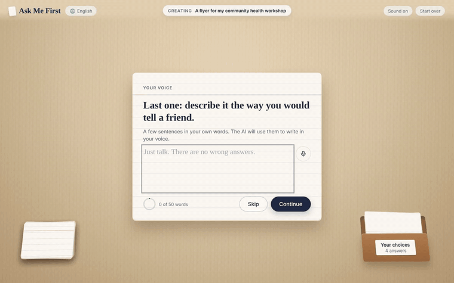
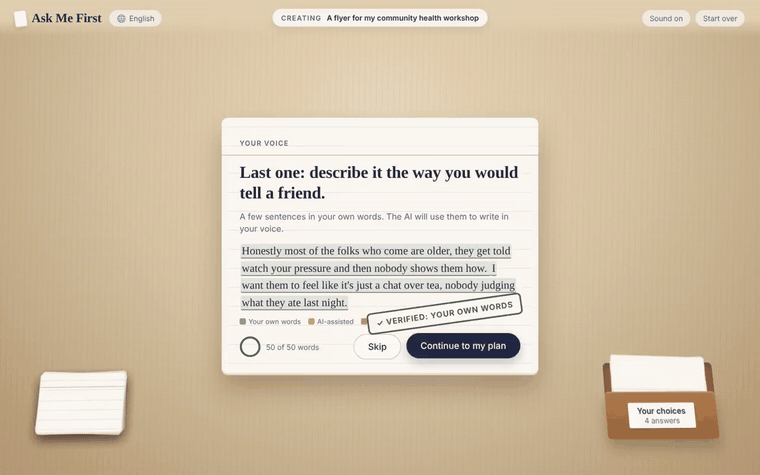
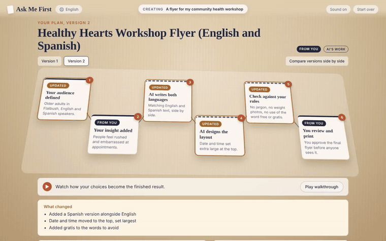
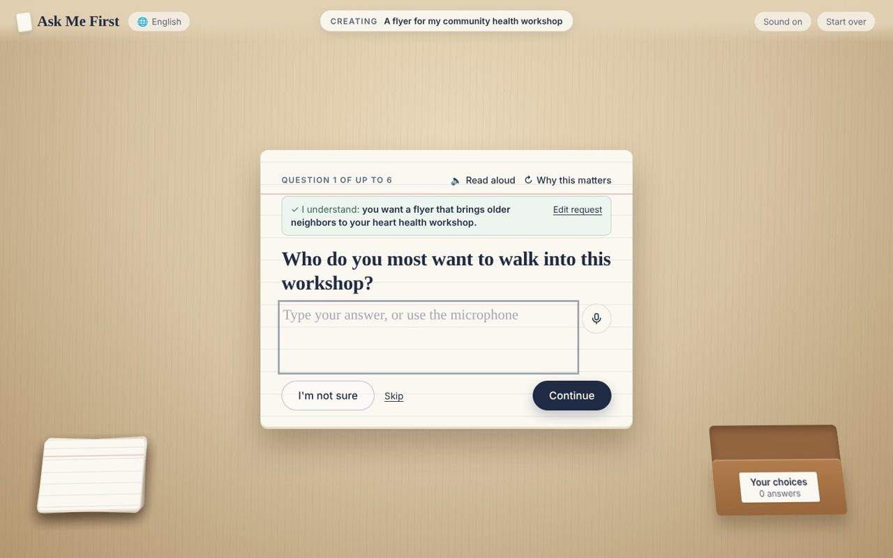
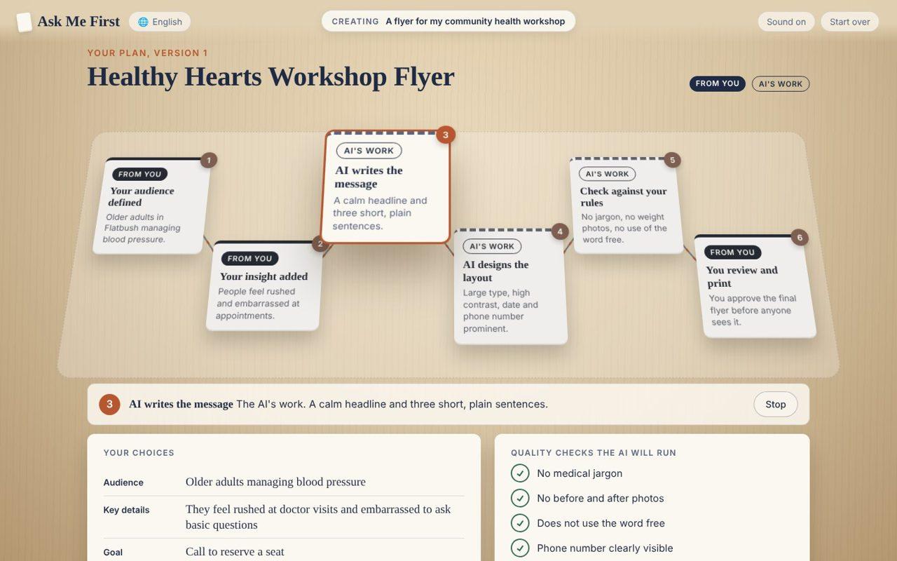
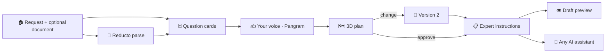

<div align="center">

# 🗂️ Ask Me First

### Most people don't know how to talk to AI. So this AI asks first.


**Cards → your voice → a plan you can see → expert instructions you can take to any AI assistant**

🏆 Built in one day at the **Non-Slop Hackathon** · Pangram × Nous Research × Reducto × Modal · Brooklyn, NY · Nov 22, 2026

👩‍💻 **Akila Lourdes** & 👨‍💻 **Akilan Manivannan**

📥 [**3-minute presentation**](docs/AskMeFirst.pptx) &nbsp;·&nbsp; 🎬 [Clips](#-see-it-in-motion) &nbsp;·&nbsp; 🚀 [Run it](#-run-it) &nbsp;·&nbsp; 🏁 [The hackathon](#-the-hackathon) &nbsp;·&nbsp; 🧱 [Architecture](docs/ARCHITECTURE.md)

[](https://github.com/AkilanManivannanak/AskmeFirst_Hackathon/actions/workflows/check.yml)

</div>

---

## 💡 The idea in one picture

> Think of a good tailor. They don't hand you a random suit. They **ask first**: what's the occasion, what fits you, what you like. Then they make it.
>
> Ask Me First does that for AI. Before anything gets written, it interviews you with a few friendly cards, learns how *you* sound, shows you the plan, and only then hands over instructions an expert would write.

| 😕 The problem | ✅ What Ask Me First does |
|---|---|
| People type "make me a flyer" and get generic AI slop | It asks the 3 to 6 questions that actually matter for *that* request |
| The result sounds like a robot, not like you | It learns your real voice from your own words, verified by Pangram |
| You can't tell what the AI decided vs. what you said | The plan marks every step as **From you** or **AI's work** |
| Non-experts don't know how to write a good prompt | It writes the expert prompt for you, ready to paste anywhere |

---

## 🎬 See it in motion

<table>
<tr>
<td width="50%" align="center"><a href="docs/videos/02_cards.mp4"></a><br><b>1 · It asks first</b><br>One card at a time, about <i>your</i> request</td>
<td width="50%" align="center"><a href="docs/videos/03_voice.mp4"></a><br><b>2 · Your voice, verified</b><br>Pangram confirms the words are yours</td>
</tr>
<tr>
<td align="center"><a href="docs/videos/04_plan.mp4"></a><br><b>3 · See the plan</b><br>From you vs. AI's work, played in 3D</td>
<td align="center"><a href="docs/videos/05_compare.mp4"></a><br><b>4 · Change it, compare</b><br>Version 2 opens like a book</td>
</tr>
<tr>
<td colspan="2" align="center"><a href="docs/videos/06_handoff.mp4"></a><br><b>5 · Take it anywhere</b><br>Preview a first draft, then one click to your AI assistant</td>
</tr>
</table>

<sub>Click any clip for the full video. Recorded from the app's built-in demo run.</sub>

---

## 🖼️ Up close

<table>
<tr>
<td align="center"><br><b>Checks it understood you</b></td>
<td align="center"><br><b>Ideas when you're unsure</b></td>
</tr>
<tr>
<td align="center"><br><b>Verified: your own words</b></td>
<td align="center"><br><b>Who decided what</b></td>
</tr>
<tr>
<td align="center"><br><b>Every change, highlighted</b></td>
<td align="center"><br><b>A real first draft</b></td>
</tr>
</table>

---

## 🏁 The hackathon

| | |
|---|---|
| 📍 **Event** | Non-Slop Hackathon, 25 Flatbush Ave, Brooklyn, NY |
| 📅 **Date** | Sunday, November 22, 2026 (one-day build) |
| 🤝 **Hosts and sponsors** | Pangram (AI-text detection) · Nous Research (Hermes models) · Reducto (document parsing) · Modal (serverless deploy) |
| 🎯 **Theme** | Build with AI without producing "slop": generic, voiceless, mass-produced AI content |
| 🧭 **Our answer** | Don't make the AI write *less*. Make it **ask more**, keep the human's voice, and show who decided what |

**How each sponsor tool is used**

| Tool | Role in Ask Me First |
|---|---|
| 🔎 **Pangram** | Reads your voice sample and confirms it's your own writing. A gentle nudge, never a gate |
| 🧠 **Hermes (Nous Research)** | Primary model for the interview and the plan when available, picked automatically |
| 📄 **Reducto** | Parses an old document you upload (resume, flyer, report) so the questions start from your real material |
| ☁️ **Modal** | One-command public HTTPS deploy, kept warm for the live demo |

---

## ✨ What makes it different

| | |
|---|---|
| 🃏 **Cards, not chat** | Up to 6 plain-language cards, each about your exact request |
| 🎯 **Never misses the essentials** | Slide count, page length, date, budget… whatever your task needs |
| 💡 **"I'm not sure" works** | 3 tailored ideas, *Use all of these*, write your own, or skip |
| ✍️ **Your real voice** | Pangram verifies your words; the AI writes like you, not like AI |
| 🗺️ **See the plan in 3D** | Steps marked *From you* or *AI's work*, plus checks from your own rules |
| 📖 **Version 2, side by side** | Ask for a change and every edit is highlighted against Version 1 |
| 🌐 **16 languages** | Screen, questions, plan, voice in and out |
| 🚀 **Works for anything** | Flyers, resumes, budgets, research, letters, decks, images |

---

## 🔁 How it works



**Example.** You type *"make a flyer for my bakery's grand opening."*
1. 🃏 Card 1 checks it understood: *"A one-page flyer announcing your bakery's opening, right?"*
2. 🃏 Next cards ask only what's missing: date and time, address, the one treat to feature, who it's for.
3. ✍️ You write two sentences about your bakery in your own words. Pangram confirms they're yours.
4. 🗺️ The plan shows "Opening date: **From you**", "Layout and headline options: **AI's work**".
5. 📋 You approve, preview a first draft, and copy the expert-level instructions into the AI tool you already use.

<details>
<summary><b>🧱 Architecture details (click)</b></summary>

```
AskmeFirst/
├── backend/
│   ├── main.py            FastAPI app: interview engine, plan, preview, voice check, upload parse
│   ├── fallbacks.py       Offline backups so the app never freezes
│   ├── modal_app.py       Modal deploy (public HTTPS, kept warm)
│   ├── smoke_test.py      Live checks for Hermes, Pangram and Reducto keys
│   ├── record_demo.py     Records a real run as the offline demo
│   ├── demo_cache.json    Stage-safe demo data (DEMO_MODE=1)
│   └── .env.example       Every setting, no secrets
├── frontend/
│   ├── index.html         One hand-written page: CSS 3D, Web Speech, Web Audio
│   └── gsap.min.js        Animation
└── docs/                  Presentation, GIFs, videos, screenshots
```

**API**

| Endpoint | What it does |
|---|---|
| `GET /api/health` | Which models and services are live |
| `POST /api/next_question` | Writes the next card from your request, answers so far and upload |
| `POST /api/plan` | Builds the plan with *From you* / *AI's work* labels |
| `POST /api/preview` | Writes a short first-draft preview |
| `POST /api/voice_check` | Sends your voice sample to Pangram |
| `POST /api/parse_upload` | Parses an uploaded document with Reducto |
| `POST /api/translate_ui` | Translates the screen into one of 16 languages |

**Keeping the interview on track.** The server, not the model, owns the rules: open topics, must-know facts per task type, a 6-card cap, no repeated or near-duplicate questions, and skips are respected. The model writes each question and plan as JSON, which the server validates before the browser ever sees it.

**Never freezes.** Every model call has a time budget and a fallback chain (Hermes → backup model → built-in fallback), and the app records which model answered each step.


Full walkthrough with diagrams: [docs/ARCHITECTURE.md](docs/ARCHITECTURE.md)

</details>

---

## 🚀 Run it

```bash
git clone git@github.com:AkilanManivannanak/AskmeFirst_Hackathon.git
cd AskmeFirst_Hackathon/backend
pip install -r requirements.txt
cp .env.example .env          # add your keys
uvicorn main:app --reload --port 8000
# open http://localhost:8000
```

| Want to… | Do this |
|---|---|
| 🎭 Demo with no keys or internet | `DEMO_MODE=1 uvicorn main:app --port 8000` |
| ☁️ Deploy a public URL | `modal deploy backend/modal_app.py` |
| 🎥 Save your run as the demo | `python record_demo.py` |
| 🩺 Check your keys work | `python smoke_test.py` |
| 🐳 Run in Docker | `docker build -t askmefirst . && docker run -p 8000:8000 -e DEMO_MODE=1 askmefirst` |
| 🧪 Run the tests (offline) | `pip install -r requirements-dev.txt && python -m pytest` |

---

<details>
<summary><b>🧪 Why we made these choices (click)</b></summary>

| Choice | Why |
|---|---|
| Cards, not chat | Non-experts write to AI like they talk to a person (*Why Johnny Can't Prompt*, CHI 2023) |
| Six questions max | Follow-up questions improve AI-written documents (Tix, 2024) |
| Checks built in | Clarifying questions raise trust but lower scrutiny (Zheng et al., arXiv preprint, 2026) |
| A real voice, not a "humanizer" | Disclose AI help, don't disguise it |
| Paper + 3D | Paper feels human; every motion explains something and stops when you read |

Who it's for: 51% of U.S. adults never use AI chatbots, about 3 in 4 over 65 (Pew Research Center, Feb 2026).

</details>

<details>
<summary><b>🔒 Security and privacy (click)</b></summary>

Keys stay on the server · input limits and a rate limit · upload type and size limits, temp files deleted · uploaded documents treated as untrusted data · same-origin CORS and security headers · no internal errors shown · run logging can be turned off (`LOG_RUNS=0`).

</details>

<details>
<summary><b>🔍 Honest notes (click)</b></summary>

- Hermes access was still being set up during the build, so a backup hosted model answered live during the demo. The app logs which model answered each step.
- The Zheng et al. paper is a preprint.
- Pangram's result is a reading, not a verdict, and it never blocks anyone.
- This is a one-day hackathon build. Offline tests cover the interview rules, the backup plan and the server guards; the live AI quality itself is checked by hand.

</details>

---

## 👥 Team

<table>
<tr>
<td align="center" width="50%">
<a href="https://github.com/AKilalours"></a><br>
<b>Akila Lourdes</b><br>
<sub>Concept · MS in AI, LIU Brooklyn</sub><br>
<a href="https://github.com/AKilalours">@AKilalours</a>
</td>
<td align="center" width="50%">
<a href="https://github.com/AkilanManivannanak"></a><br>
<b>Akilan Manivannan</b><br>
<sub>Co-builder · MS in AI, LIU Brooklyn</sub><br>
<a href="https://github.com/AkilanManivannanak">@AkilanManivannanak</a>
</td>
</tr>
</table>

<div align="center">

*"When you can generate anything, what matters is what you chose."*

</div>
