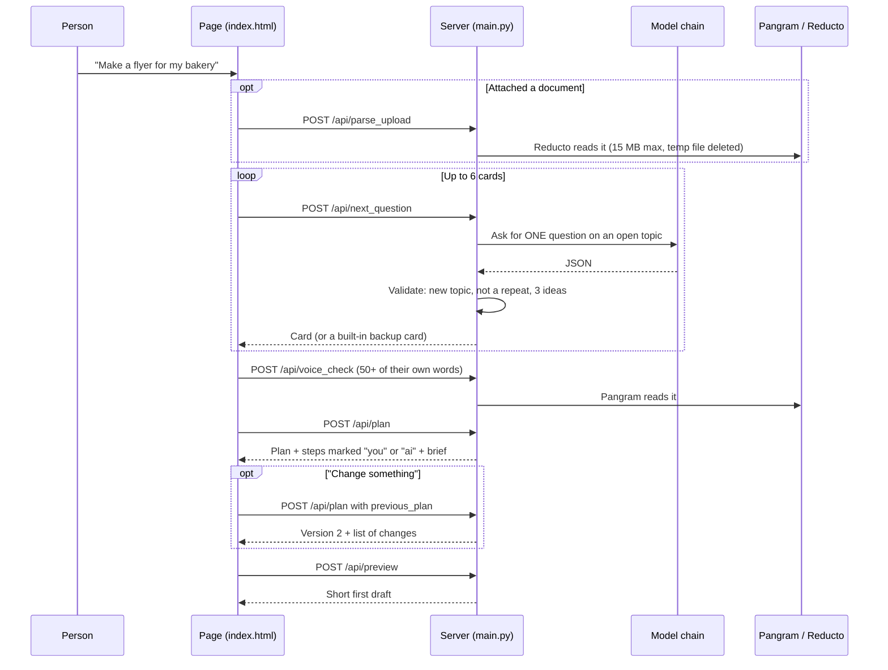
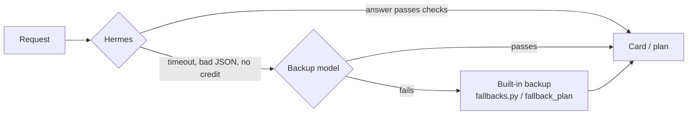

# 🧱 How Ask Me First works

> **One-line version:** the browser shows cards, the server owns the rules, the models only fill in words, and every step has a backup.

Think of it like a restaurant. The **page** is the waiter: friendly, shows you the menu. The **server** is the head chef: decides what gets cooked and in what order. The **models** are line cooks: fast and talented, but the chef checks every plate before it leaves the kitchen.

---

## 🗺️ The whole trip

---

## 🃏 The interview rules (enforced by the server, not the model)

| Rule | Value | Where |
|---|---|---|
| Most cards | 6 | `MAX_QUESTIONS` |
| Fewest cards before the model may stop | 4 | `MIN_QUESTIONS` |
| Topics, in backup order | audience → purpose → key details → format → style → avoid | `FALLBACK_ORDER` |
| Last card if limits never came up | always asks what to **avoid** | `next_question` |
| Same-topic repeat | blocked at **40%** word overlap | `too_similar` |
| Any-topic near copy | blocked at **70%** word overlap | `_near_identical` |
| Skipped questions | never asked again, even reworded | `next_question` |
| Must-know facts | one list per kind of task (11 kinds) | `ESSENTIALS` |
| Ideas per card | exactly 3 | `validate_q` |

**Example of the repeat rule.** Request: *"flyer for my bakery"*. Card 2 asked *"Which colors and fonts do you like?"* If the model then offers *"What colors should it use?"*, the shared meaningful word is *colors* (the request's own words like *bakery* and *flyer* don't count). Overlap is 50%, above 40%, so the server rejects it and asks again.

---

## 🔁 The backup chain

- **One time budget for the whole chain:** 40 s for a card, 90 s for a plan. Each model gets a share (62% if another follows), and each can retry once.
- **The answer must pass the checks**, not just arrive. A reply with no JSON, a repeated question or fewer than 3 ideas counts as a failure and moves down the chain.
- **The page is told who answered** (`source`: `hermes`, the backup's name, `fallback` or `demo`), so a demo never pretends a backup was the primary model.

---

## 📄 Two outside services

| Service | When | Limits | If it fails |
|---|---|---|---|
| 🔎 **Pangram** | Voice card, only at 50+ words, only the person's own words | 20 s timeout | Card still works; it simply isn't verified |
| 📄 **Reducto** | Person attaches a file | 15 MB, 14 file types, temp file deleted, 45 s | Person continues without the document |

---

## 🎭 Demo mode

`DEMO_MODE=1` replays `backend/demo_cache.json` with realistic delays. No keys, no network: the safe choice for a stage or a job interview. `python record_demo.py` turns your latest real run into that file.

---

## 🔒 Safety, in one table

| Risk | Guard |
|---|---|
| Keys leaking | Server only; `.env` is git- and Docker-ignored; CI fails on a key in `.env.example` |
| Budget burn | 90 POSTs per visitor per 5 minutes (`RATE_LIMIT_PER_5MIN`) |
| Malicious upload | Type and size limits; text treated as data, never instructions |
| Clickjacking, sniffing | `X-Frame-Options: DENY`, `nosniff`, `no-referrer` on every response |
| Serving private files | `/static/` only serves a whitelist (`gsap.min.js`) |
| Leaky errors | Friendly messages only; details go to the server log |

All of these are covered by `backend/tests/`, which run offline with no keys.
